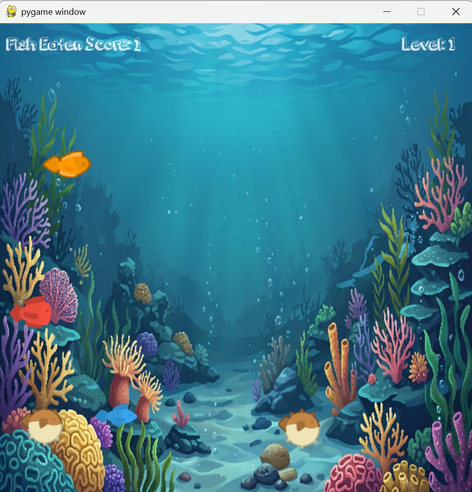

# MIDN 3/C Chloe Haseltine's Fish Game
Final project for EW200

### Description
In fish game your goal is to eat all the fish in every level and survive the pufferfish

This is a screenshot from the actual game:

#### How to Play:
1. Clone this repository
2. Install pygame-ce with pip install pygame-ce
3. run game.py, python3 game.py
 _______________________________________________________________________

1. Use the arrow keys to move the fish around
2. Eat all the colored fish
3. Avoid hitting the pufferfish! They will kill you and end the game!
4. Eating all fish will advance you in levels 
